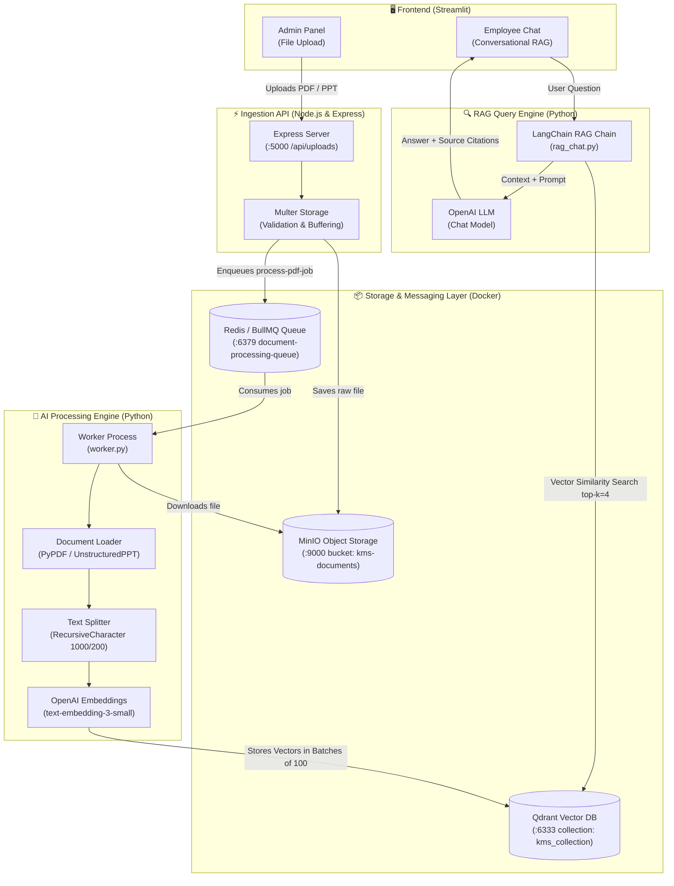

# 🧠 Enterprise Knowledge Management System (KMS)

An enterprise-grade, RAG-powered Knowledge Management System (KMS) designed for intelligent document ingestion, automated vectorization, and conversational retrieval with citation sources.

This system enables organizations to upload internal company documents (PDFs, PPT/PPTX presentations, policies, manuals) and query them seamlessly using an AI-powered conversational interface.

---

## 🏗️ Architecture & Data Flow



---

## 📁 Repository Structure

```text
├── docker-compose.yml       # Docker services: Qdrant (Vector DB), Redis (Queue), MinIO (Object Storage)
├── backend_node/            # Node.js Express server for file ingestion & job dispatch
│   ├── src/
│   │   ├── controllers/     # Request handlers (uploadController.js)
│   │   ├── middlewares/     # Multer file validation (uploadMiddleware.js)
│   │   ├── repositories/    # MinIO storage client (minioRepository.js)
│   │   ├── routes/          # API routes (uploadRoutes.js)
│   │   ├── services/        # Business logic & BullMQ producer (uploadService.js)
│   │   └── server.js        # Express app entry point
│   ├── .env.example         # Template for Node.js environment variables
│   └── package.json         # Node.js dependencies and scripts
├── ai_python/               # Python AI worker and RAG query engine
│   ├── worker.py            # BullMQ worker: downloads docs, splits text, creates embeddings & saves to Qdrant
│   ├── rag_chat.py          # RAG retrieval chain using LangChain, Qdrant & OpenAI
│   ├── .env.example         # Template for Python environment variables
│   └── requirements.txt     # Python dependencies
├── streamlit-ui/            # Interactive web user interface
│   ├── src/
│   │   └── streamlit_ui/
│   │       └── app.py       # Streamlit UI with Admin Upload & Employee Chat
│   └── pyproject.toml       # Streamlit UI package and dependency configuration
└── README.md                # Project documentation
```

---

## ⚙️ Prerequisites

Before getting started, ensure you have the following installed on your system:

- **[Docker Desktop](https://www.docker.com/products/docker-desktop/)** (with Docker Compose)
- **[Node.js](https://nodejs.org/)** (v18 or higher recommended) & `npm`
- **[Python](https://www.python.org/)** (v3.10 or higher) or **[`uv`](https://github.com/astral-sh/uv)** package manager
- **[OpenAI API Key](https://platform.openai.com/api-keys)** with access to embeddings and chat models

---

## 🚀 Quick Start Guide

Follow these steps in separate terminal windows to get all services up and running.

### Step 1: Start Infrastructure (Docker)

Launch Qdrant, Redis, and MinIO in the background:

```bash
docker compose up -d
```

Verify that all containers are healthy:

```bash
docker compose ps
```

| Service | Port | Purpose | Web Console / Dashboard |
| :--- | :--- | :--- | :--- |
| **Qdrant** | `6333`, `6334` | Vector Database | [http://localhost:6333/dashboard](http://localhost:6333/dashboard) |
| **Redis** | `6379` | BullMQ Job Queue | `redis-cli -p 6379` |
| **MinIO** | `9000` (API), `9001` (UI) | Object Storage | [http://localhost:9001](http://localhost:9001) (`admin` / `password123`) |

---

### Step 2: Configure & Start Node.js Backend

The backend handles document upload requests, saves files to MinIO, and dispatches jobs to Redis.

1. Navigate to `backend_node`:
   ```bash
   cd backend_node
   ```

2. Create `.env` from template:
   ```bash
   # On Linux / macOS:
   cp .env.example .env

   # On Windows (PowerShell):
   Copy-Item .env.example .env
   ```

3. Install dependencies:
   ```bash
   npm install
   ```

4. Start the server (runs on `http://localhost:5000`):
   ```bash
   npm start
   ```

---

### Step 3: Configure & Start AI Python Background Worker

The Python worker listens to Redis for upload events, pulls files from MinIO, chunks them, generates OpenAI embeddings, and indexes them in Qdrant.

1. Open a new terminal and navigate to `ai_python`:
   ```bash
   cd ai_python
   ```

2. Create `.env` from template:
   ```bash
   # On Linux / macOS:
   cp .env.example .env

   # On Windows (PowerShell):
   Copy-Item .env.example .env
   ```

3. Add your OpenAI API key in `ai_python/.env`:
   ```env
   OPENAI_API_KEY=sk-your-actual-openai-api-key-here
   ```

4. Create and activate a virtual environment:
   ```bash
   # Using Python venv:
   python -m venv .venv

   # Activate on Windows:
   .\.venv\Scripts\activate

   # Activate on Linux/macOS:
   source .venv/bin/activate
   ```

5. Install dependencies:
   ```bash
   pip install -r requirements.txt
   ```

6. Start the worker:
   ```bash
   python worker.py
   # Or if using uv:
   # uv run worker.py
   ```

You should see:
```text
qudrant Collection kms_collection is already present
OpenAI embedding model is Ready!!
Python worker is Active... wait for the New PDF(stop: CTRL+C)
```

---

### Step 4: Start Streamlit Web UI

The Streamlit UI provides an administrative file uploader and an employee-facing chat assistant.

1. Open a new terminal and navigate to `streamlit-ui`:
   ```bash
   cd streamlit-ui
   ```

2. Activate the virtual environment or use `uv`:

   **Option A: Using `uv` (Recommended)**
   ```bash
   uv run streamlit run src/streamlit_ui/app.py
   ```

   **Option B: Using standard `pip`**
   ```bash
   # Activate your Python virtual environment (e.g. from ai_python or a new one)
   pip install streamlit requests langchain langchain-openai langchain-qdrant qdrant-client
   python -m streamlit run src/streamlit_ui/app.py
   ```

3. Open your browser at:
   ```text
   http://localhost:8501
   ```

---

## 🔒 Configuration & Environment Variables

### `backend_node/.env`
| Variable | Default Value | Description |
| :--- | :--- | :--- |
| `PORT` | `5000` | Port for the Express server |
| `MINIO_ENDPOINT` | `localhost` | MinIO host |
| `MINIO_PORT` | `9000` | MinIO S3 API port |
| `MINIO_USE_SSL` | `false` | Enable/disable SSL for MinIO |
| `MINIO_ACCESS_KEY` | `admin` | MinIO access key (matches docker-compose) |
| `MINIO_SECRET_KEY` | `password123` | MinIO secret key (matches docker-compose) |
| `MINIO_BUCKET_NAME` | `kms-documents`| MinIO bucket name for stored files |

### `ai_python/.env`
| Variable | Default Value | Description |
| :--- | :--- | :--- |
| `OPENAI_API_KEY` | `None` (Required) | API Key for OpenAI embeddings & LLM |

---

## 💡 How to Use

### 1. Uploading Documents (Admin Panel)
1. Open the Streamlit web interface at `http://localhost:8501`.
2. Expand the sidebar titled **🔒 Admin Panel**.
3. Enter the default admin password: `admin`.
4. Drag and drop or browse for files (`.pdf`, `.ppt`, `.pptx`).
5. Click **Upload to Database**.
6. The files will be transferred to Node.js backend, stored in MinIO, enqueued to Redis, and automatically processed by `worker.py` into Qdrant.

### 2. Asking Questions (Employee Chat)
1. In the main chat area, type your query (e.g., *"What is the company leave policy?"* or *"Summarize project milestones"*).
2. The system retrieves relevant chunks from Qdrant, synthesizes the answer with OpenAI, and outputs:
   - The concise, context-grounded response.
   - **📚 Sources**: A list of original filenames used to answer the question.

---

## 🛠️ Tech Stack Breakdown

- **Frontend**: [Streamlit](https://streamlit.io/)
- **Backend API**: [Express.js](https://expressjs.com/), [Multer](https://github.com/expressjs/multer), [BullMQ](https://docs.bullmq.io/)
- **AI & RAG Framework**: [LangChain](https://www.langchain.com/), [LangChain-Qdrant](https://github.com/langchain-ai/langchain)
- **Embeddings & LLM**: OpenAI (`text-embedding-3-small`, `gpt-4o` / OpenAI models)
- **Vector Database**: [Qdrant](https://qdrant.tech/)
- **Object Storage**: [MinIO](https://min.io/) (S3 Compatible)
- **Message Broker & Queue**: [Redis](https://redis.io/)
- **Containerization**: [Docker & Docker Compose](https://www.docker.com/)

---

## ❓ Troubleshooting & FAQs

<details>
<summary><b>1. "Could not connect to the backend. Is your Node.js server running?"</b></summary>

Ensure the Node.js server is started on port 5000:
```bash
cd backend_node
npm start
```
Check if `http://localhost:5000` is accessible.
</details>

<details>
<summary><b>2. "Redis connection refused (ECONNREFUSED 127.0.0.1:6379)"</b></summary>

Make sure Docker is running and the Redis container is active:
```bash
docker compose up -d redis
```
</details>

<details>
<summary><b>3. "MinIO connection error or bucket creation failure"</b></summary>

Verify MinIO is running and credentials match between `docker-compose.yml` and `backend_node/.env`:
- Access MinIO UI at `http://localhost:9001` with `admin` / `password123`.
- Check if bucket `kms-documents` exists or let the backend create it automatically.
</details>

<details>
<summary><b>4. "OpenAI AuthenticationError or Missing API Key"</b></summary>

Ensure `OPENAI_API_KEY` is set in `ai_python/.env`. Verify that your OpenAI account has available credits/quota.
</details>

<details>
<summary><b>5. Changing the LLM model in RAG Chat</b></summary>

In [ai_python/rag_chat.py](ai_python/rag_chat.py), locate the LLM initialization:
```python
llm = ChatOpenAI(model="gpt-4o-mini", temperature=0.3)
```
Update `model` to any supported OpenAI chat model (such as `gpt-4o-mini`, `gpt-4o`, etc.).
</details>

---

## 📜 License

This project is licensed under the ISC License. Feel free to customize and extend for your enterprise needs!
